# Data model

Postgres on Supabase. The schema lives in [`supabase/migrations/`](../supabase/migrations/) and is tested by [`supabase/tests/`](../supabase/tests/) (`npm run test:db`). Issue: [TYL-7](https://linear.app/tyler-solo/issue/TYL-7/design-core-data-model).

## Diagram

```mermaid
erDiagram
    recipe_sources ||--o{ recipes : publishes
    recipe_sources ||--o{ crawl_pages : "sitemap URLs"
    recipe_sources ||--o{ crawl_runs : "crawl log"
    crawl_pages |o--o| recipes : "imported as"
    recipes ||--o{ recipe_ingredients : "has lines"
    recipes ||--o{ recipe_cuisines : ""
    recipes ||--o{ recipe_diets : ""
    cuisines ||--o{ recipe_cuisines : ""
    diets ||--o{ recipe_diets : ""
    ingredients ||--o{ recipe_ingredients : "mapped to"
    ingredients ||--o{ ingredient_aliases : "known as"

    users ||--|| profiles : ""
    users ||--o{ user_diets : ""
    users ||--o{ user_favorite_cuisines : ""
    users ||--o{ user_favorite_ingredients : ""
    users ||--o{ user_disliked_ingredients : ""
    users ||--o{ user_saved_recipes : ""
    users ||--o{ user_pantry_staples : ""

    store_chains ||--o{ stores : ""
    store_chains ||--o{ store_products : sells
    ingredients ||--o{ store_products : "matched to"
    users ||--o{ user_stores : "shops at"
    stores ||--o{ user_stores : ""
    users ||--o{ user_product_choices : ""

    ingredients ||--o{ prices : ""
    store_products ||--o{ prices : ""
    stores ||--o{ prices : ""

    users ||--o{ meal_plans : ""
    meal_plans ||--o{ meal_plan_entries : ""
    recipes ||--o{ meal_plan_entries : ""
    users ||--o{ shopping_lists : ""
    meal_plans ||--o| shopping_lists : generates
    shopping_lists ||--o{ shopping_list_items : ""

    recipes {
        uuid id PK
        text source_url UK
        text title
        jsonb instructions "only if rights allow"
        text visibility "public | private"
        text status "active | needs_review | hidden | removed"
    }
    recipe_ingredients {
        uuid recipe_id FK
        smallint line_no "same line = alternatives"
        smallint option_no
        text raw_text
        uuid ingredient_id FK "null until mapped"
        numeric quantity
        numeric quantity_max "ranges"
        text unit
        bool is_optional
    }
    ingredients {
        uuid id PK
        text name UK
        text aisle
        text[] contains "meat, fish, dairy, gluten..."
        numeric grams_per_cup
        numeric grams_per_each
    }
    diets {
        text slug PK
        text[] excludes
    }
    prices {
        uuid id PK
        text source "user | store_api | deal | baseline_*"
        uuid ingredient_id FK
        uuid store_product_id FK
        uuid store_id FK "null = baseline"
        uuid user_id FK "only for user prices"
        int price_cents
        numeric quantity
        text unit
        date valid_to "deals"
    }
    profiles {
        uuid user_id PK
        int weekly_budget_cents
        smallint household_size
        text home_zip
        text[] allergens
    }
    meal_plans {
        uuid id PK
        uuid user_id FK
        date week_start
        int budget_cents
    }
    shopping_list_items {
        uuid shopping_list_id FK
        text name
        numeric quantity
        int est_price_cents "snapshot"
        text price_source
        timestamptz checked_at
    }
```

## Key decisions

### Diet labels come from ingredients

- Every canonical ingredient lists what it **contains** (`meat`, `poultry`, `fish`, `shellfish`, `gelatin`, `dairy`, `egg`, `honey`, `gluten`, `tree_nut`, `peanut`, `soy`, `sesame`).
- Each diet lists what it **excludes**. Vegetarian excludes meat, poultry, fish, shellfish and gelatin; vegan also excludes dairy, egg and honey. Adding a diet is a data change, not a code change.
- `recipe_meets_diet(recipe, diet)` decides. It returns:
  - **true** when every required line has at least one option that fits;
  - **false** when some line has no option that fits;
  - **null** when it can't tell (an option isn't mapped to a canonical ingredient yet). Unknown recipes get no label rather than a wrong one.
- Results are stored in `recipe_diets` with where they came from (`derived`, `publisher`, `manual`):
  - **derived** labels are recomputed by `refresh_recipe_diets()` whenever a recipe's ingredients are stored (`set_recipe_ingredients()`: imports, re-imports, re-parses). A recipe earns a diet when every required line fits. If it fits only when some ingredient is bought without something some brands add (refried beans without lard), it still earns the label, and `checks` names those ingredients and what they may contain (`recipe_label_checks()`). "Can't tell" (unmatched ingredients) earns nothing, and a recipe with no ingredient lines gets no labels.
  - **publisher** rows are the source's own `suitableForDiet` tags, kept as a hint; a derived label for the same diet replaces them, and the app never shows them.
  - **manual** labels from a reviewer are never overwritten.
- The app shows Vegan (instead of Vegetarian), Vegetarian, Gluten-free and Dairy-free. A label with checks is starred, with a note like "Check the refried beans: some brands contain meat." A general note says to check packaging for allergies.

### Diet customization

Users get three kinds of control (TYL-32):

- **Hard rules** filter recipes out. They combine the user's diet presets (`user_diets`), extra categories to avoid on top of those (`profiles.avoid_categories`, e.g. vegetarian + `animal_rennet`), and allergies (`profiles.allergens`). Presets now include no red meat, no pork, no alcohol and shellfish-free.
- **"May contain"** (`ingredients.may_contain`) marks uncertainty: Parmesan may use animal rennet, flour tortillas may use lard. A recipe that only fits if the right product is bought gets a **check-the-label** status instead of being hidden. Users can switch to leaving such recipes out (`profiles.strict_may_contain`). Allergies are always strict.
- **Soft goals** (`user_diet_goals`) are planner targets that hide nothing: specific days ("Meatless Mondays": vegetarian dinners on day 1) or a weekly count ("4 vegetarian dinners a week").
- **Weights** (`user_category_weights`) nudge recommendations: −1 (much less) to +1 (much more) per category, e.g. `meat` at −0.5.

`recipe_fit_for_user(recipe, user)` returns `fits`, `check_label`, `unknown` or `excluded`, built on `recipe_rule_status(recipe, excludes, strict)`. Recipe diet labels (`recipe_meets_diet`) are only earned by a clear `fits`.

### Alternatives and ranges

- One row in `recipe_ingredients` per ingredient **option**. "2 tbsp fish sauce (or soy sauce)" becomes two rows on the same `line_no`, so the recipe still counts as vegetarian.
- `quantity` and `quantity_max` hold ranges ("1–2 tbsp").
- Optional lines are ignored for diet checks; the planner should leave out optional ones that break a user's diet.

### One price table for every source

- `prices` holds user entries, Kroger store prices, deals, and BLS/USDA baselines, each tagged with `source`.
- A row means "`price_cents` buys `quantity` `unit`" (249 for 14 oz), so package prices and unit prices fit the same shape.
- Lookup order per ingredient and store: **user → store_api → deal → baseline** (TYL-13, TYL-28). That logic lives in the API.
- User-entered prices are private to the user (RLS).
- Shopping list items keep a **snapshot** of the price and its source, so the total doesn't change mid-shop.

### Baseline prices

- `supabase/migrations/20261007030000_baseline_prices.sql` seeds 105 ingredients with a baseline price each. It's generated by `apps/api/scripts/build_baseline_prices.py`; edit the script, not the SQL.
- Sources: BLS average prices for the South (staples, last published January 2025), USDA ERS fruit and vegetable prices (national, 2023), both adjusted to the latest CPI "food at home" index, plus `apps/api/data/seed_prices.csv`, a short list of rough hand estimates for items neither source covers (tofu, spices, oils).
- The API's `app/pricing/estimate.py` picks a price per ingredient and store in the lookup order above and converts units (cups, pounds, each) using each ingredient's `grams_per_cup` and `grams_per_each`.
- Re-run the script to refresh prices; a scheduled job can replace it later.

### Recipe content rights

- `recipe_sources.content_rights` is `link_only` by default: we keep metadata and ingredients and link out for instructions. `instructions` is only filled for `public_domain` or `licensed` sources, or a user's own private recipe. Full rules: [policies/recipe-sources.md](policies/recipe-sources.md) (TYL-27).
- `opted_out_at` records a site asking to be removed. `opt_out_source()` sets it, stops crawling, and hides the site's public recipes.
- `crawl_enabled` is only set after the per-site check, recorded in `crawl_notes`.
- New recipes start as `needs_review` and aren't shown publicly until they're `active`.

### Ingredient lines (TYL-9)

- Each line is parsed by the API (`app/recipes/ingredients.py`, using `ingredient-parser-nlp`) into `quantity` (and `quantity_max` for ranges), `unit`, `name`, `preparation`, `note` and `is_optional`, with `parse_confidence`. Units use the names in `app/pricing/units.py` (`cup`, `tbsp`, `oz`, `each`…) or a plain singular word (`clove`, `pinch`). "1 (15 oz) can beans" is stored as 15 oz with the note "1 can".
- "A or B" lines become one row per option, sharing `line_no`. "Salt and pepper" stays one row, flagged for review.
- `ingredient_id` comes from `match_ingredient()`: the first of the API's candidate names (as written, then without words like "fresh" or "large", singular/plural, "canned …" for cans) that is a canonical ingredient or an `ingredient_aliases` entry. Unmatched lines keep their `name` and get `needs_review`.
- The canonical ingredient list grows from `apps/api/data/ingredients.csv` (name, aisle, `contains`, `may_contain`, aliases): `apps/api/scripts/build_ingredients.py <version>_<name>` validates it and writes a new migration. Existing names and aliases are never overwritten, and the schema tests check every row and alias landed as written.
- **Weights** (`grams_per_cup`, `grams_per_each`) let the planner turn cups and items into weights to add up and price. They come from USDA FoodData Central, SR Legacy (public domain): `apps/api/data/fdc_map.csv` names each ingredient's FDC food (checked by hand) and, when needed, which portion counts as "one" (or `-` for none); `scripts/build_weights.py <fdc_dir> <version>_<name>` writes `data/ingredient_weights.csv` and a migration. Weights set by hand earlier are kept.
- **Measurement equivalencies** (TYL-79): standard units, including kitchen ones (pinch, dash, smidgen, stick = 8 tbsp, deciliter), are a table in `app/pricing/units.py`. The parser adds compound amounts up with it ("1 cup + 2 tbsp" → 1.125 cup, "1 lb 4 oz" → 1.25 lb). Units that depend on the ingredient (a clove of garlic, a stick of butter, a slice of bread, a bunch of cilantro) are in `ingredient_units` (grams per unit), built by `scripts/build_weights.py` from USDA portions plus `data/unit_equivalents.csv` (hand values win). The planner converts through them, and items sold by the bunch are packaged as "1 bunch".
- `set_recipe_ingredients()` replaces a recipe's lines; `scripts/reparse_ingredients.py` re-parses stored recipes after the parser or aliases change.

### Openly licensed sources (TYL-45)

- `recipe_sources.license_name`, `license_url` and `attribution` record a source's license; the recipe page shows them. The Wikibooks Cookbook is seeded as `licensed` (CC BY-SA 4.0), not `crawl_enabled`: `scripts/import_wikibooks.py` reads it through the MediaWiki API and `app/recipes/wikibooks.py` parses each page.
- Imported recipes start private and `needs_review`, like any import with no `added_by`. `publish_licensed_recipes(source)` (service role only) makes the ones with ingredients and steps public and active.

### Find: search by intent (search_recipes)

- `read_search_query()` reads a query into ingredients (via `match_ingredient`), cuisines, diets, courses ("dessert", "breakfast", "soup") and time ("quick", "under 30"); leftover words search titles and summaries (`recipes.search`).
- `recipe_ingredients.grams` is each line's estimated weight (`line_grams()`: the `units` table, a copy of `app/pricing/units.py` kept in step by a unit test, plus `ingredient_units`, `grams_per_cup` and `grams_per_each`), set by a trigger; `refresh_line_grams()` recomputes after weights change.
- `search_recipes(query, limit, offset)` ranks public, active recipes for the signed-in user: how much of the dish the searched ingredients are by weight, title and text matches, favorite cuisines and ingredients up, disliked ingredients far down, sauces and drinks down unless asked for. `recipe_fit_for_user` leaves out recipes that break the user's rules; for a user with rules, ones Sous can't fully check come after the rest.
- `recipes.courses` comes from the source's categories (Wikibooks), set by `import_recipes()`.
- The catalog leaves out what doesn't belong (human placenta, dog meat, pet food, endangered species): `apps/api/data/catalog_exclusions.csv`, applied on import, which also hides excluded recipes already loaded.

### Browser imports (TYL-35)

- `recipes.origin` is `fetched` (Sous read the page, or a user typed the recipe) or `browser` (sent from a user's browser for a site that blocks Sous).
- A fetched recipe is shared by every user who imports its URL (unique `source_url` among fetched recipes). A browser recipe is a private copy for `added_by` only (unique per URL and user), and a check constraint keeps it private, so made-up browser data can't reach other users.

### Hand-typed recipes (TYL-35)

- A recipe a user types in has no `source_url`, is always `private` to `added_by`, and keeps everything they entered, instructions included. `recipes.source_note` (up to 300 characters) records where it came from in their words ("Grandma", a cookbook and page).
- `save_manual_recipe()` (service role only, called by `POST`/`PUT /recipes/manual`) creates or edits one: it replaces the ingredient lines through `set_recipe_ingredients()`, so they're parsed and diet-labelled like any other recipe, and saves the recipe to the user. Editing only works on the user's own hand-typed recipes.

### Preferences (TYL-14, TYL-24)

- The web app writes the user's own rows directly under RLS: `profiles` (allergies, extra categories to avoid, `strict_may_contain`, household size, weekly budget in cents) and one row per choice in `user_diets`, `user_favorite_cuisines`, `user_favorite_ingredients` and `user_disliked_ingredients`. Saving replaces each set.
- A user with no `profiles` row hasn't set preferences yet, and the recipe list offers to set them up.

### Meal plans (TYL-15)

- One `meal_plans` row per user and week; weeks start on Monday (check constraint). `budget_cents` overrides the profile's weekly budget for that week when set.
- `meal_plan_entries` hold a recipe, its size (`scale`: 0.5, 1 or 2 for half, full or double) and optionally a day in the week (null means "some day this week"). Row-level security only lets a user plan recipes they can see, so another user's private recipe can't be planned.
- The web app edits plans directly. `add_to_meal_plan()` creates the week's plan on first use; `copy_meal_plan()` copies a week into another, keeping weekdays and skipping recipes no longer active. `my_recipe_fits()` returns `recipe_fit_for_user()` for the signed-in user, which the planner uses as a hard filter (`excluded` recipes can't be added).

### Buying and the pantry (TYL-15, TYL-18, TYL-49)

- Each ingredient says how it's bought (`apps/api/data/packaging.csv`, turned into a migration by `scripts/build_packaging.py`): `sold_by = 'package'` with a typical `package_quantity` and `package_unit` (a 15 oz can, a 2 lb bag, a bunch, one lemon), or `'loose'`, bought by the amount needed (produce by the pound, meat from the counter). `pantry_staple` marks things most kitchens keep (salt, oil, spices).
- `user_pantry` is the start of the pantry tracker: per user and ingredient, `have` (on hand, don't buy) or `out` (buy it). With no row, staples count as on hand and everything else is bought.
- `GET /api/plans/{week}/cost` prices the week like a shopping trip. `plan_cost_inputs()` (service role only) returns the entries, their ingredient lines, how each ingredient is bought, the user's pantry and the prices that apply to them. `app/plans/cost.py` adds each ingredient up across the week (each recipe at its size), rounds packaged ones up to whole packages (an unknown amount, like "salt to taste", buys one), prices loose ones by the amount, and skips what's on hand. It returns the list of items with what to buy, the leftover from the last package, and the price.

### Crawling (TYL-26)

- `crawl_pages` is the queue: one row per sitemap URL with its `lastmod` and what happened when we fetched it. `crawl_enqueue()` adds new URLs and re-queues a page only when its `lastmod` moves forward; blocked and disallowed pages are never re-queued automatically.
- `crawl_runs` logs each nightly run per site: counts, and why it stopped if it did.
- `import_recipe()` with `refresh: true` updates a changed recipe in place (same content-rights rules) and sends it back to `needs_review`.

### Access (row level security)

- **Catalog** (recipes, ingredients, diets, cuisines, stores, products, shared prices): readable by anyone, written only by the API using the service role.
- **Crawler** (`crawl_pages`, `crawl_runs`): RLS with no policies, so only the service role can see them.
- **Recipes:** anyone sees public `active` ones; users also see recipes they added. Ingredient lines, cuisines and diet labels follow their recipe.
- **User data** (profile, favorites, plans, lists, own prices, own stores): only the owner can read or write.

### Other choices

- Money is integer cents. IDs are UUIDs. Timestamps are `timestamptz`.
- Recipes are never deleted (`status = removed`), so old meal plans keep working.
- Cuisines, diets and store chains are lookup tables seeded in the migration.
- Recipe search uses a Postgres full-text index on title and summary to start.

## Not modeled yet

- **Households:** sharing a plan or list with family (TYL-18). Plans and lists are per user for now; adding a `household_id` later is straightforward.
- **Nutrition** (TYL-11, after v1).
- **Assistant conversations** (TYL-25).
