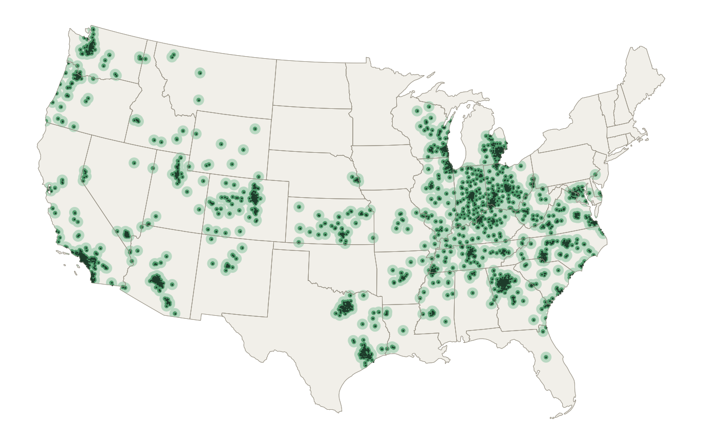

# Kroger-family store coverage

Sous gets live shelf prices only from Kroger-family stores (Kroger, Harris Teeter, Ralphs, Fred Meyer, King Soopers, Smith's, Fry's and 13 more brands). This measures where that reaches. The work was done 2026-10-17; the full report page is at https://claude.ai/artifact/VqDQA9N4piHhfarFJsjW69.



## Findings

- **2,774 stores** in 36 states plus DC: 2,504 priced through Kroger's product matches, and 270 Harris Teeter priced through its own.
- **40%** of people live within 5 miles of one, **47%** within 10, and **58%** within 25. These are straight-line distances; driving is longer.
- **Strong:** Ohio Valley, Georgia and the Carolinas, Virginia (Virginia Beach is 96% within 10 miles), Colorado, Utah, Arizona, Nevada, Southern California and the Pacific Northwest, plus Dallas and Houston.
- **No stores at all:** NY, MA, MN, OK, CT, IA, HI, NH, ME, RI, SD, ND, VT.

Metros of a million or more with essentially no coverage:

| Metro              | People | Within 10 mi | Median distance |
| ------------------ | ------ | ------------ | --------------- |
| New York, NY-NJ    | 20.1M  | 0%           | 90 mi           |
| Miami, FL          | 6.1M   | 0%           | 205 mi          |
| Boston, MA-NH      | 4.9M   | 0%           | 275 mi          |
| Minneapolis, MN-WI | 3.7M   | 0%           | 148 mi          |
| Tampa, FL          | 3.2M   | 0%           | 60 mi           |
| Orlando, FL        | 2.7M   | 4%           | 29 mi           |
| San Antonio, TX    | 2.6M   | 0%           | 154 mi          |
| Pittsburgh, PA     | 2.5M   | 1%           | 33 mi           |
| Austin, TX         | 2.3M   | 0%           | 87 mi           |
| Kansas City, MO-KS | 2.2M   | 4%           | 26 mi           |
| San Jose, CA       | 2.0M   | 0%           | 31 mi           |
| Providence, RI-MA  | 1.7M   | 0%           | 241 mi          |
| Oklahoma City, OK  | 1.4M   | 0%           | 113 mi          |
| Buffalo, NY        | 1.2M   | 0%           | 176 mi          |
| Grand Rapids, MI   | 1.2M   | 0%           | 54 mi           |
| Rochester, NY      | 1.1M   | 0%           | 235 mi          |
| Urban Honolulu, HI | 1.0M   | 0%           | 2395 mi         |
| Tulsa, OK          | 1.0M   | 0%           | 92 mi           |
| New Orleans, LA    | 1.0M   | 0%           | 135 mi          |

Partly covered (ask testers there for their zip first):

| Metro                     | People | Within 10 mi | Median distance |
| ------------------------- | ------ | ------------ | --------------- |
| Philadelphia, PA-NJ-DE-MD | 6.2M   | 27%          | 16 mi           |
| San Francisco, CA         | 4.7M   | 65%          | 7 mi            |
| St. Louis, MO-IL          | 2.8M   | 54%          | 10 mi           |
| Sacramento, CA            | 2.4M   | 56%          | 8 mi            |
| Cleveland, OH             | 2.2M   | 16%          | 17 mi           |
| Jacksonville, FL          | 1.6M   | 29%          | 14 mi           |
| Birmingham, AL            | 1.2M   | 40%          | 13 mi           |
| Fresno, CA                | 1.2M   | 66%          | 6 mi            |

**What it means for Sous:**

- **Recruit testers** in covered metros: Los Angeles, Chicago, Dallas, Houston, Atlanta, Phoenix, Riverside, Detroit, Seattle, San Diego, Denver, Portland, and others.
- **Elsewhere, prices are estimates.** The plan page says so (TYL-88 follow-up, PR #58).
- **Where a second price source would help most:** the Northeast, Florida, the Upper Midwest, central Texas and Oklahoma. That could be another chain, or prices users enter (TYL-62).

## Method

1. **Stores** (`harvest.py`):
   - sweep a hex grid of 100-mile searches over the US with the Locations API (`filter.latLong.near`, limit 200);
   - split any search that returns exactly 200. Kroger's reported total is capped at the limit too, so it can't show a cut-off search;
   - about 410 calls (1,600 a day are allowed). Vitacost's online-only locations are left out.
2. **People:** 2020 Census tract population-weighted centres ([CenPop2020_Mean_TR](https://www2.census.gov/geo/docs/reference/cenpop2020/tract/CenPop2020_Mean_TR.txt), about 84,000 tracts).
3. **Distance** (`analyze.py`): great-circle miles from each tract centre to its nearest store. Shares are by population; metros are the 2023 metropolitan statistical areas ([delineation file](https://www2.census.gov/programs-surveys/metro-micro/geographies/reference-files/2023/delineation-files/list1_2023.xlsx)).
4. **Outputs** (to `data/out/`):
   - shapefiles: `kroger_stores`, `coverage_10mi` and `coverage_25mi` (buffered in EPSG:5070 and clipped to land), `uncovered_tracts_25mi`;
   - CSVs by state and by metro;
   - the map (`static_map.py`).

## Rerunning

Kroger's store data and the Census downloads live in `data/`, which is gitignored. Only the method, the findings and the map are kept here.

```sh
# 1. Stores (needs KROGER_CLIENT_ID/SECRET in the environment)
cd apps/api && .venv/bin/python ../../docs/research/kroger-coverage/harvest.py

# 2. Census inputs, into docs/research/kroger-coverage/data/census/
#    tracts.txt  (CenPop2020_Mean_TR.txt), states.zip (cb_2023_us_state_20m.zip),
#    cbsa.xlsx   (list1_2023.xlsx)

# 3. Analysis and map (a separate environment: geopandas, shapely, pyproj,
#    scipy, matplotlib, openpyxl, pyogrio)
python analyze.py && python static_map.py
```
